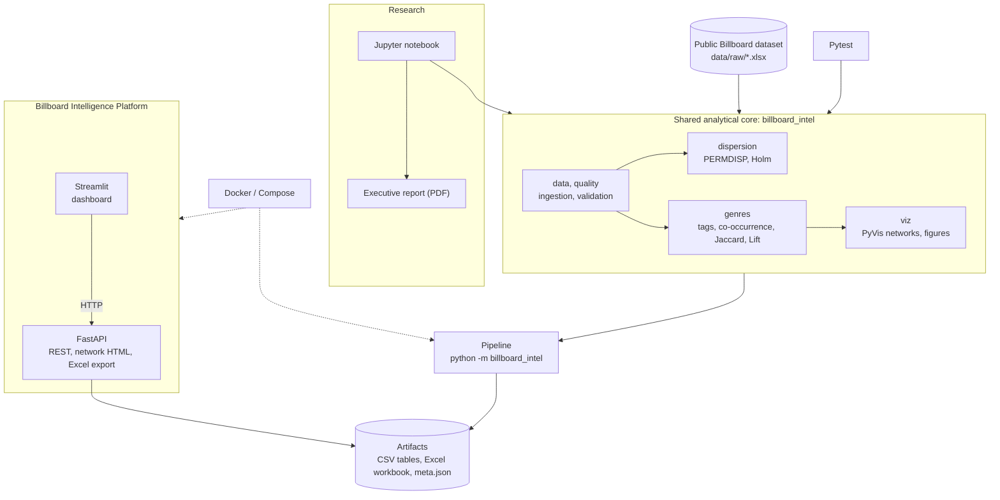
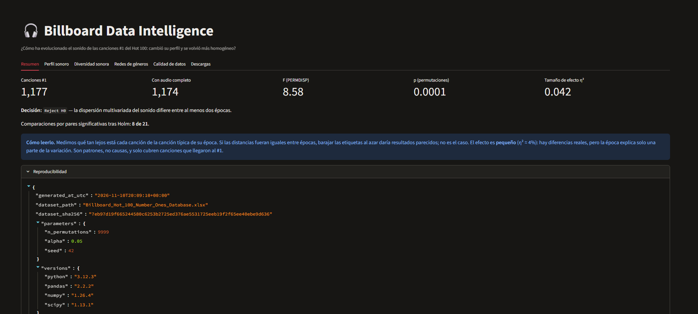
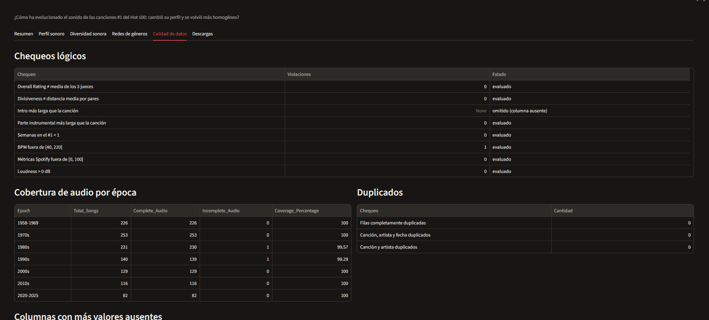
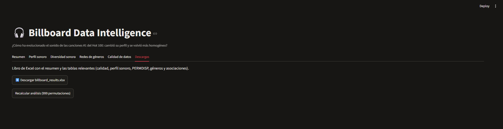
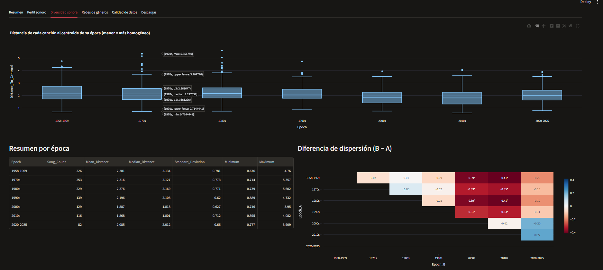
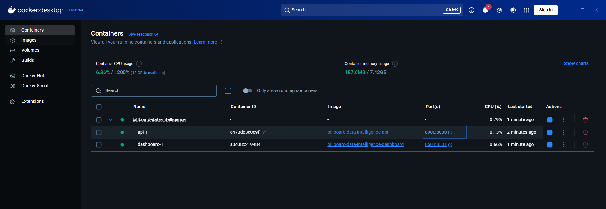
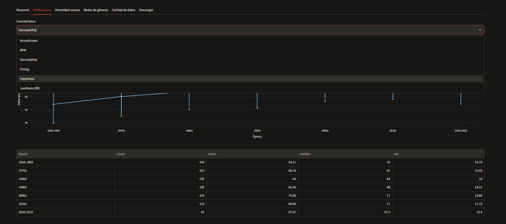
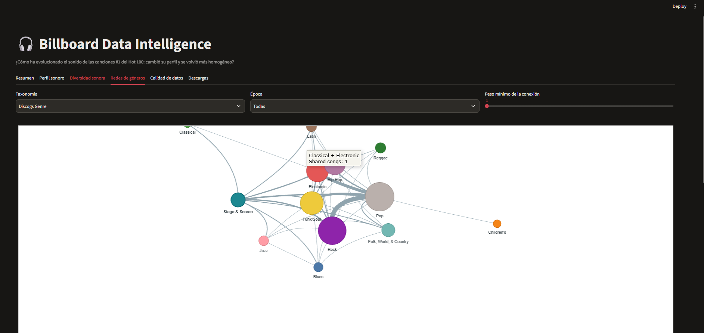
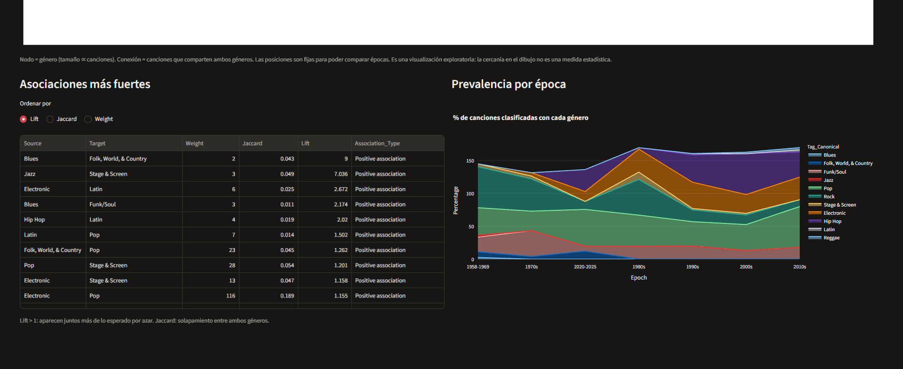

# Billboard Data Intelligence

**From historical music data to analytical insights and production-ready data products.**

An end-to-end project exploring how the sound of Billboard Hot 100 #1 songs (1958–2025) has evolved. It combines statistical analysis, data engineering, and software engineering to turn a public dataset into reproducible research and an operational analytics platform.

The project follows two complementary tracks:

- **Analytical Research:** formulate and test a data-driven hypothesis, communicate statistically supported findings, and deliver reproducible research.
- **Platform Engineering:** operationalize the same workflow through a reusable Python package, a REST API, an interactive dashboard with network visualizations, automated tests, and containerization.

The objective is not simply to analyze a dataset or build a dashboard. It is to show how a business question can become a validated analytical result and a maintainable data product.

---

## Start here (for reviewers)

| What | Where |
|---|---|
| **Executive report** (non-technical, 2 pages) | [`deliverables/executive_report.pdf`](deliverables/executive_report.pdf) |
| **Analysis notebook, rendered** (code + charts + interactive genre network) | [`deliverables/billboard_analysis_01.html`](deliverables/billboard_analysis_01.html) |
| **Results workbook** (all tables, run metadata, dataset SHA-256) | [`deliverables/billboard_results.xlsx`](deliverables/billboard_results.xlsx) |
| Analysis notebook, executable | [`notebooks/billboard_analysis_01.ipynb`](notebooks/billboard_analysis_01.ipynb) |
| Platform (API + dashboard + Docker) | [Section 4](#4-billboard-intelligence-platform) and [Section 7](#7-reproducibility--execution) |
| How the work evolved | [`notebooks/exploration/`](notebooks/exploration/) |

The three files in `deliverables/` are a frozen snapshot of one run. Report, notebook, and workbook were cross-checked against each other (same F, p, η², sample sizes, and per-era distances).

---

## Key finding

> The diversity of sound among #1 songs **is not constant over time**, but the change is **modest** and **not a continuous trend toward homogenization**.

| Result | Value |
|---|---|
| Test | PERMDISP (9,999 permutations) on 6 standardized audio features |
| Global result | F = 8.58, p = 0.0001 → reject H0 |
| Effect size | η² = 0.042 (small: era explains ~4% of the variation in distances) |
| Pairwise (Holm-corrected, 21 comparisons) | 8 significant, all between 1958–1999 and the 2000s/2010s |
| Magnitude | Mean distance to the era centroid ≈ 16% lower in 2000–2019 (1.88) than before 2000 (2.25) |
| 2020–2025 | Dispersion rises again (2.09) but is **not** significant after correction |

Songs of the 2000s and 2010s are more tightly clustered in sound than songs from 1958–1999, but the data does not support a continuous homogenization trend up to the present. These are associations, not causes, and they describe only songs that reached #1.

> Figures come from the real dataset. Reproduce them with `python -m billboard_intel`; the golden test (`pytest -m golden`) checks sample sizes, F and η² against the original analysis. The pipeline was also run inside the Docker image (Python 3.12) and gave the same numbers as the local run (Python 3.13).

---

## Why this isn't just another data analysis notebook

A notebook can produce interesting charts, but analytical work becomes more valuable when its logic is reusable, its assumptions are explicit, and its results reproduce independently of the development environment.

1. **Start with a question, not a tool.** The question determines the methods and the engineering. *Here it is inferential, so no predictive model was built.*
2. **Separate research from application logic.** Ingestion, validation, and statistics live in one Python package. The notebook, API, dashboard, and tests all consume it.
3. **Make results defensible.** Significance, effect sizes, multiple-comparison correction, data quality, and limitations matter more than impressive charts.
4. **Design for reproducibility.** Fixed seed, SHA-256 of the source file, recorded library versions, automated tests, documented steps.
5. **Build for operational continuity.** The analysis runs from the command line, is testable, and is exposed through an API.

> Choose analytical methods and engineering complexity based on the problem, not on the technology stack.

---

## 1. Research Problem

### Dataset

Songs that reached #1 on the Billboard Hot 100 between August 1958 and January 2025: **1,177 records and 105 attributes** (1,174 with complete audio features).

| Domain | Examples |
|---|---|
| Chart performance | Weeks at Number One, Non-Consecutive |
| Music metadata | Song, Artist, Date, Label |
| Audio characteristics | BPM, Energy, Danceability, Happiness, Loudness, Acousticness |
| Genre taxonomies | CDR Genre/Style, Discogs Genre/Style |
| Instrumentation | Guitar, Piano, Strings, Horns, Bass |
| Song structure | Time Signature, Length, Intro Length, Song Structure |
| Artist attributes | Origin, Age, demographic metadata |
| Creative contributors | Songwriters, Producers, Featured Artists |
| Lyrics | Lyrics, Lyrical Topic, Lyrical Narrative |
| Human assessments | Individual Ratings, Overall Rating, Divisiveness |

**Data source:** [Billboard Hot 100 Number Ones Database](https://docs.google.com/spreadsheets/d/1rYTaNWB5-ZLvb54v0HV0kfzb6oUWQW-zkgyT-u7VaiY/edit?usp=sharing) (public). The audio features are algorithmic estimates provided with the dataset.

### Research question

**How has the sound of Billboard Hot 100 #1 songs evolved: has its sonic profile changed, and has it become more homogeneous over time?**

The question contains two phenomena that can occur independently: the *average* sound can shift while the *spread* around it stays the same (or vice versa). The formal hypothesis targets the second, diversity; the first is described through per-era sound profiles.

- **H0:** The multivariate dispersion of the audio characteristics is comparable across historical periods.
- **H1:** The multivariate dispersion differs between at least two historical periods.

| Element | Definition |
|---|---|
| Unit of analysis | A song, in the era of its debut at #1 |
| "Sound" | 6 audio features (BPM, Energy, Danceability, Happiness, Loudness, Acousticness), globally standardized |
| "Diversity" | Distance of each song to the centroid of its era (smaller = more homogeneous) |
| Eras | 1958–69, 1970s, 1980s, 1990s, 2000s, 2010s, 2020–25 |
| Test | PERMDISP: ANOVA on distances, p-value by permutation of era labels |
| Post hoc | All 21 pairwise comparisons with Holm correction |

**In plain language.** We measure how far each song is from the "typical song" of its era, then ask whether those distances differ between eras by more than shuffling the era labels at random would produce.

**Transparency note.** The hypothesis was refined after an initial exploration of distributions and data coverage, so it is **not pre-registered**. This is compensated by Holm correction, reported effect sizes, and a fixed seed.

### Why this question matters

Knowing whether chart-topping music has converged or diversified shows how production technology, distribution channels, and listening habits shape what reaches the top. It is also a clean example of separating *change in the average* from *change in the spread*.

### Methodological considerations and how they are handled

| Consideration | Treatment | Status |
|---|---|---|
| Selection bias (only #1 songs) | Declared as a scope limit; no claims about what makes a song reach #1 | Documented |
| Audio metrics are estimates (e.g., BPM errors) | BPM outside [40, 220] flagged and excluded only from the analytic sample | ✅ Done |
| Different number of #1s per era | Reported in the descriptive tables | Documented |
| Missing data | "Not applicable" blanks are not imputed; 3 songs lack complete audio | ✅ Done |
| Multiple comparisons | Holm correction (21 tests) | ✅ Done |
| Associations ≠ causation | Wording of all conclusions | Documented |
| Songs by the same artist are not independent | Artist-level resampling | ⬜ Pending (stated as a limitation) |
| Half/double-tempo artifacts in BPM (possible driver of the 2020–25 rise) | Sensitivity analysis with folded BPM / without BPM | ⬜ Pending (stated as a limitation) |
| Genre mix changes across eras (e.g., hip hop) | Within-genre comparison | ⬜ Pending (stated as a limitation) |

The pending checks are listed as open items in both the notebook and the executive report. They are not claimed as done.

---

## 2. Project Architecture

Data processing, analytical logic, API services, and presentation are separated. **The same Python package powers the notebook, the command-line pipeline, the API, and the tests.**



| Component | Responsibility | Technology |
|---|---|---|
| Data ingestion | Load the Excel without modifying the original | Python, Pandas |
| Data quality | Schema checks, duplicates, missing values, logical rules from the data dictionary | `quality.py` |
| Analytics engine | Standardization, distance to centroid, PERMDISP, pairwise tests, Holm | NumPy, SciPy (vectorized) |
| Genre network engine | Tag normalization, co-occurrence, Jaccard/Lift, graph layout | NetworkX |
| Visualization | Static figures and interactive networks | Matplotlib, PyVis, Plotly |
| Pipeline and artifacts | Reproducible run, CSV tables, Excel workbook, run metadata | Python, OpenPyXL |
| API layer | Serve results, networks, and exports; trigger recomputation | FastAPI |
| Presentation | Interactive exploration (no analytical logic) | Streamlit |
| Testing | Unit, statistical, data-quality, and API tests | Pytest |
| Packaging | Single dependency source and editable install | `pyproject.toml` |
| Containerization | Reproducible multi-service environment | Docker, Docker Compose |

### Separation of responsibilities

| Layer | Does | Does not |
|---|---|---|
| `src/billboard_intel/` | Ingestion, validation, statistics, networks, export | Know about HTTP or Streamlit |
| `api/` | Expose results and networks; recompute on demand | Contain analytical logic |
| `app/` | Visualize and interact | Compute anything: all data comes from the API |
| `notebooks/` | Narrate the analysis | Duplicate code: it imports the package |

The pipeline writes **artifacts** and the API serves them, so the dashboard stays responsive even though the permutation tests take seconds to compute.

---

## 3. Analytical Workflow

Six stages. ✅ implemented, ⬜ pending.

**01 — Problem framing**
- ✅ Business question, null and alternative hypotheses.
- ✅ Assumptions, biases, and methodological limitations documented.
- ✅ Analytical design (unit, features, eras, test).

**02 — Data engineering**
- ✅ Ingest the original dataset (raw data never modified); validate schema and required columns.
- ✅ Missing, inconsistent, and duplicate values; numerical ranges and logical constraints (e.g., Overall Rating equals the mean of the three judges).
- ✅ Normalize genre tags (`;` separators, canonical variants such as `Funk / Soul`).
- ✅ Dates, historical periods, and a documented analysis-ready sample with assertions.

**03 — Exploratory & statistical analysis**
- ✅ Descriptive statistics and per-era sound profiles; correlation analysis.
- ✅ Genre co-occurrence (Jaccard and Lift).
- ⬜ Within-genre comparison to separate genre-mix effects from convergence.

**04 — Hypothesis testing**
- ✅ PERMDISP (no normality assumption), effect size η², 9,999 permutations, Holm over 21 pairs.
- ⬜ Bootstrap confidence intervals for dispersion differences.
- ⬜ Robustness checks (folded/without BPM, artist-level resampling).

**05 — Communication**
- ✅ Executive report for a non-technical audience (PDF).
- ✅ Excel workbook with the relevant tables.
- ✅ Interactive dashboard and network visualizations.

**06 — Reproducibility**
- ✅ Reusable package with editable install; seed, source hash, parameters, and versions saved with every run.
- ✅ Automated validations and a golden test against the original results.

| Stage | Notebook section | Package |
|---|---|---|
| 01 Problem framing | 01 | — |
| 02 Data engineering | 02, 03 | `data.py`, `quality.py` |
| 03 Exploratory & statistical | 04 | `dispersion.epoch_profile`, `genres.py` |
| 04 Hypothesis testing | 05 | `dispersion.py` |
| 05 Communication | 06 | `viz.py`, `app/`, `api/` |
| 06 Reproducibility | 07 | `pipeline.py`, `tests/` |

---

## 4. Billboard Intelligence Platform

### Dashboard (Streamlit)

| Tab | Content |
|---|---|
| Overview | Headline numbers (F, p, η²), decision, plain-language reading with caveats |
| Sound profile | Mean ± SD of each audio feature by era |
| Sonic diversity | Distance-to-centroid distribution by era, pairwise matrix with Holm significance |
| Genre networks | Interactive PyVis network by taxonomy, era, and minimum edge weight; strongest associations (Lift / Jaccard); prevalence by era |
| Data quality | Logical checks, audio coverage by era, duplicates, missing values |
| Downloads | Excel workbook and recompute button |

### REST API (FastAPI)

| Endpoint | Purpose |
|---|---|
| `GET /health`, `/summary` | Service status; run metadata (dataset hash, parameters, versions, headline results) |
| `GET /profile`, `/epochs` | Per-era sound profile and audio coverage |
| `GET /dispersion`, `/dispersion/songs`, `/dispersion/permdisp`, `/dispersion/pairwise` | Diversity results and tests |
| `GET /genres/sources`, `/genres/{source}/prevalence`, `/associations`, `/node-metrics` | Genre analytics |
| `GET /networks/{source}`, `/networks/{source}/html` | Network as JSON or self-contained PyVis HTML (filters: `epoch`, `min_weight`) |
| `GET /quality`, `/export/excel` | Data-quality tables; Excel workbook |
| `POST /pipeline/run` | Recompute and persist the artifacts |

Interactive documentation is available at `/docs`.

### Processing pipeline

```text
Source Excel (never modified)
      |
      v
Schema validation  -->  Quality checks (duplicates, missing, logical rules)
      |
      v
Preparation: dates, eras, BPM flag, analytic sample (with assertions)
      |
      +--> Sound profile per era
      +--> Distance to centroid --> PERMDISP --> pairwise tests --> Holm
      +--> Genre tags --> co-occurrence --> Jaccard / Lift --> network layout
      |
      v
Artifacts: CSV tables + Excel workbook + meta.json (hash, parameters, versions)
```

### Screenshots











### Machine Learning strategy

**No predictive model is included, by design.** The question is inferential (does the dispersion of sound differ across eras?), and there is no defensible prediction target that would add information. Adding a model to claim ML would contradict the first principle of the project. If a future question requires prediction, the plan is: explicit target definition, train/validation/test separation, baseline comparison, leakage prevention, and persisted artifacts.

---

## 5. Software Quality

### Automated testing

Pytest validates:

- **Preparation:** required columns, epoch boundaries, raw data left unmodified, BPM handling.
- **Quality checks**, including graceful handling of absent columns.
- **Statistics:** Holm against `statsmodels`, ANOVA against `scipy`, PERMDISP detects a real difference and not noise, reproducibility with a fixed seed.
- **Genre logic:** separators, canonical variants, co-occurrence weights, Jaccard and Lift on hand-computed values, prevalence denominators.
- **Pipeline:** artifact round-trip, Excel workbook structure, command-line interface.
- **API:** all endpoints, input validation, missing results, eras with no classified songs.
- **Golden test** (`pytest -m golden`): reproduces the sample sizes and global PERMDISP statistics of the original analysis on the real dataset. It is skipped when the dataset is absent.

### Containerization

Docker Compose defines three services: a one-shot `pipeline`, the `api`, and the `dashboard`. The pipeline run inside the container reproduces the local results exactly (same F, p, η², pairwise decisions), which is evidence that the results do not depend on the environment.

---

## 6. Repository Structure

```text
Billboard-Data-Intelligence/
│
├── deliverables/                 # frozen snapshot of one run (start here)
│   ├── executive_report.pdf
│   ├── billboard_analysis_01.html
│   └── billboard_results.xlsx
│
├── notebooks/
│   ├── billboard_analysis_01.ipynb   # clean analysis notebook (imports the package)
│   └── exploration/                  # original working notebooks (exploration history)
│
├── src/billboard_intel/
│   ├── config.py                 # constants and parameters
│   ├── data.py                   # ingestion, eras, analytic sample
│   ├── quality.py                # audits and logical checks
│   ├── dispersion.py             # distance to centroid, PERMDISP, pairwise, Holm
│   ├── genres.py                 # tags, co-occurrence, Jaccard/Lift, graphs
│   ├── viz.py                    # figures and PyVis networks
│   ├── pipeline.py               # run, artifacts, Excel export
│   ├── cli.py                    # python -m billboard_intel
│   └── synthetic.py              # synthetic data for tests and demos
│
├── api/main.py                   # FastAPI
├── app/streamlit_app.py          # dashboard
├── tests/                        # unit, statistical, data quality, API, golden
│
├── data/
│   ├── raw/                      # Billboard_Hot_100_Number_Ones_Database.xlsx
│   └── processed/
├── artifacts/                    # generated by the pipeline (not versioned)
├── docs/             # platform screenshots
│
├── Dockerfile
├── docker-compose.yml
├── Makefile
├── pyproject.toml
├── pytest.ini
└── README.md
```

---

## 7. Reproducibility & Execution

### Local environment

```bash
python -m venv .venv

# Windows
.venv\Scripts\activate
# Linux / macOS
source .venv/bin/activate

pip install -e ".[dev]"
```

### Data

The public dataset is expected at:

```text
data/raw/Billboard_Hot_100_Number_Ones_Database.xlsx     (sheet name: Data)
```

### Validate against the original results

```bash
pytest -m golden        # real dataset required
pytest -v               # full suite
```

### Run the pipeline (generates `artifacts/`)

```bash
python -m billboard_intel                 # 9,999 permutations
python -m billboard_intel --n-perm 199    # quick run
```

### Run the platform (two terminals)

```bash
uvicorn api.main:app                      # http://localhost:8000/docs
streamlit run app/streamlit_app.py        # http://localhost:8501
```

### Run the notebook

```bash
jupyter lab
```

Open `notebooks/billboard_analysis_01.ipynb` and **Run All**. The first cell locates the repository root, installs the package if missing, and checks the import, so it works from any working directory. Set `NB_N_PERM=199` for a faster run.

> If you see `ModuleNotFoundError: billboard_intel`, the Jupyter kernel is not the Python environment where the package was installed. Register the kernel from the active environment: `python -m ipykernel install --user --name billboard --display-name "Python (billboard)"` and select it.

To regenerate the rendered notebook (code and charts included):

```bash
jupyter nbconvert --to html --embed-images notebooks/billboard_analysis_01.ipynb
```

### Docker

```bash
docker compose run --rm pipeline --n-perm 199
docker compose up --build # API :8000, dashboard :8501
```

`docker compose run --rm pipeline --n-perm 199`

### Without the real dataset

`python -m billboard_intel.synthetic <path>.xlsx` generates **synthetic** data with the same structure, useful for demos and tests. It is not real data and does not reproduce the findings.

---

## 8. Deliverables

**Analytical research (primary)**
- Executive report for a non-technical audience (`deliverables/executive_report.pdf`).
- Reproducible Jupyter notebook in seven sections, plus its rendered HTML.
- Results workbook with run metadata and the relevant tables.
- Hypothesis, PERMDISP, pairwise tests with Holm correction, effect sizes, genre network analysis.
- Explicit discussion of limitations and confidence in the findings.

**Software and data platform (complementary)**
- Reusable Python package with a command-line pipeline.
- FastAPI backend and Streamlit dashboard with interactive network visualization.
- Automated tests, including a golden test.
- Docker environment.

The research is the primary evaluation deliverable. The platform shows how the same analytical logic can be operationalized.

---

## 9. From analysis to decision

This is an exercise on public music data, not a credit model. The practices it demonstrates do carry over to decision-oriented analytics:

| Practice here | Why it matters in decision work |
|---|---|
| Hypothesis → data → analysis → result → decision | The workflow of any analytical question that ends in an action |
| Holm correction and effect sizes | The same discipline needed to evaluate experiments and policy changes with several comparisons |
| Data-quality gates before modeling | Equivalent to data contracts: bad inputs are caught before they reach a result |
| Notebook → package → CLI → API | A path from exploration to something other systems can consume |
| Fixed seed, hash, versions, golden test | Results that can be audited and reproduced |
| Pragmatic scope (no ML without a target) | A well-supported simple answer beats an unnecessary complex one |

---

## 10. Engineering Decisions

| Decision | Rationale |
|---|---|
| Shared analytical core | One place to fix a bug; notebook, API, dashboard, and tests agree by construction |
| Artifacts between pipeline and API | Heavy computation runs once; the API answers in milliseconds and every run is traceable |
| PERMDISP + Holm | Multivariate dispersion with no normality assumption; controlled family-wise error across 21 comparisons |
| Vectorized permutation engine | 9,999 permutations for the global test and all 21 pairs in about 15 seconds |
| Effect size alongside p-values | With n ≈ 1,100, significance alone says little about practical relevance (η² = 0.042) |
| Self-contained PyVis networks with fixed layout | Work offline; node positions stay stable across eras so networks are comparable |
| No machine learning | The question is inferential; there is no justified prediction target |
| Docker and Compose | Reproducible environment, results identical to the local run |
| No CI pipeline | Deliberately left out: the project is validated locally with pytest and the container run, and a pipeline would add maintenance without adding evidence |

---

## 11. Current State & Roadmap

| Area | Status |
|---|---|
| Research problem, hypothesis, limitations | ✅ Complete |
| Data profiling, quality validation, preparation | ✅ Complete |
| Hypothesis test (PERMDISP + Holm) | ✅ Complete |
| Result artifacts and Excel workbook | ✅ Complete |
| Executive report and rendered notebook | ✅ Complete |
| FastAPI backend, Streamlit dashboard, network visualizations | ✅ Complete |
| Automated tests and golden test | ✅ Complete |
| Docker / Docker Compose | ✅ Pipeline reproduces local results |
| Robustness checks (folded/without BPM, artist-level resampling, within-genre) | ⬜ Pending |
| Bootstrap confidence intervals | ⬜ Pending |
| Machine learning component | ➖ Not applicable by design |

### Next steps

1. Run the pending robustness checks and add them to the package with tests; update the notebook, workbook, and report.
2. Add bootstrap confidence intervals for the dispersion differences.
3. Document architectural decisions in `docs/decisions/`.

---

## 12. AI-Assisted Development

This project was developed with AI assistance, which the assessment allows. The author is fully responsible for the analysis, the code, and the conclusions.

| Tool | Primary use |
|---|---|
| Gemini | Analytical reasoning, hypothesis framing, and conceptual review |
| ChatGPT | High-level architecture, workflow design, and component layout |
| Claude | Code implementation, logic debugging, and technical refinement |

**What stayed with the author**

- Choosing the question and pivoting it as the data revealed what it could answer.
- Inspecting the data and deciding how to treat anomalies (e.g., excluding a 16-BPM measurement error while keeping real young-artist ages).
- Running the pipeline, API, dashboard, tests, and containers, and validating the results against the original notebook with the golden test.
- Interpreting the results and stating their limits, including what the data does **not** support.

The original working notebooks are kept in `notebooks/exploration/` as a record of the exploration process; they are superseded by `notebooks/billboard_analysis_01.ipynb`.

---

## 13. Project Philosophy

Analytical thinking and software engineering are not separate activities. A strong analytical result should be reproducible, a data pipeline should be validated, an application should have clear responsibilities, and every architectural decision should have a reason behind it.

**From a question to evidence. From evidence to intelligence. From intelligence to an operational product.**

---

## Stack

**Data & Analytics:** Python, Pandas, NumPy, SciPy, NetworkX, Jupyter  
**Visualization:** Matplotlib, Plotly, PyVis  
**Backend:** FastAPI  
**Frontend:** Streamlit  
**Testing & Quality:** Pytest, Ruff  
**Infrastructure:** Docker, Docker Compose  
**Version Control:** Git, GitHub